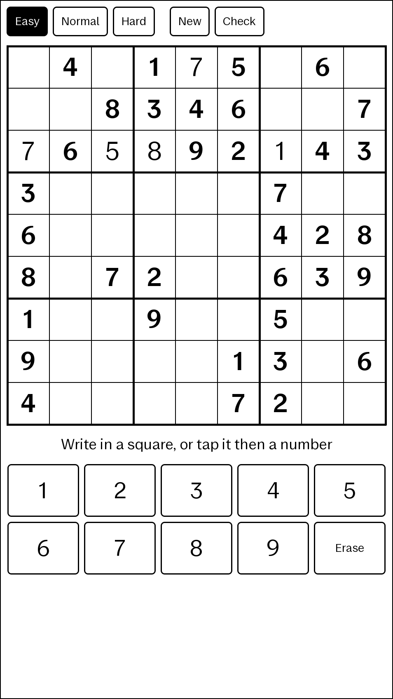

# Sudoku

Sudoku for the reMarkable Paper Pro family, as an [AppLoad](https://github.com/asivery/rm-appload) app.
Write a number in a square with the pen, or tap a square then a number on
the keypad. Scribble over a square, or rub it with the pen's eraser, to clear it.



- Three levels, all with a unique solution:
  - Easy: 36 givens, solvable by filling squares that have a single possible number
  - Normal: as few givens as possible, still solvable that way
  - Hard: as few givens as possible, needing more than that
- Duplicates in a row, column or box are circled; Check strikes out wrong numbers.
- The game in progress is saved in `~/.local/share/sudoku/game` and resumed
  when the app opens again.

The backend (`backend/`) generates puzzles, recognizes handwritten digits and
saves the game. The frontend (`ui/main.qml`) is loaded by AppLoad inside xochitl.

## Handwriting

Digits are recognized by a small [dlib](http://dlib.net/) network in
`data/digits.dat` (the one reCrossable uses for letters, with 9 outputs),
trained on MNIST's 1 to 9. Pen strokes and MNIST images go through the same
normalization (`backend/digits.h`). To retrain, download and gunzip
[MNIST](https://storage.googleapis.com/cvdf-datasets/mnist/)'s four files into
a directory, then:

```sh
build-pc/train_digits <mnist directory> data/digits.dat
build-pc/test_digits data/digits.dat   # synthetic pen strokes
```

## Building

In `nix develop` (from [nix-remarkable-sdk](https://github.com/cyprienruffino/nix-remarkable-sdk)):

```sh
# On the PC: tests, and the app with its backend
cmake -B build-pc -G Ninja && cmake --build build-pc && ctest --test-dir build-pc
cmake --install build-pc --prefix dist-pc/sudoku
appload-run dist-pc/sudoku
build-pc/entry --generate hard

# On the tablet
cmake -B build-rm -G Ninja -DCMAKE_TOOLCHAIN_FILE=$RM_TOOLCHAIN_FILE && cmake --build build-rm
cmake --install build-rm --prefix dist/sudoku
rm-deploy dist/sudoku
```
